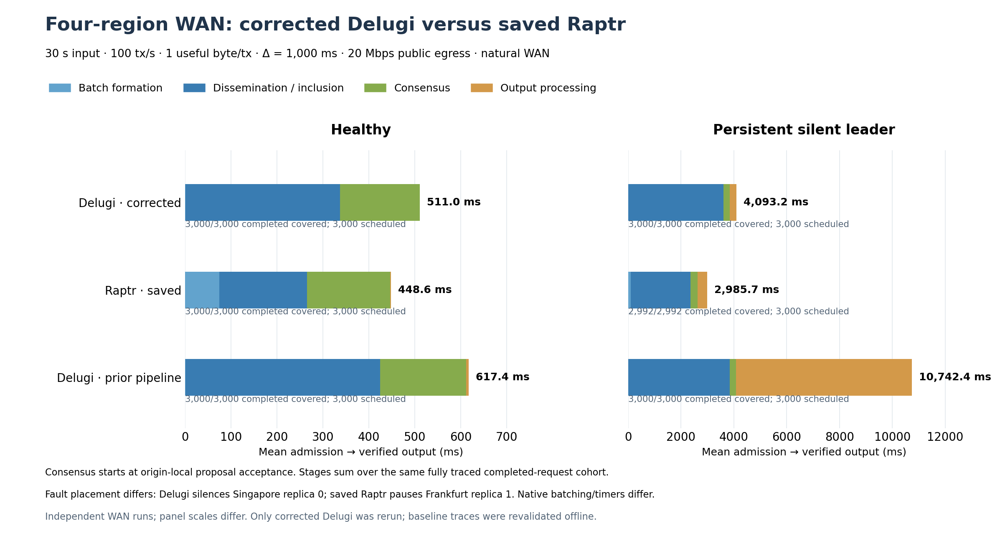

# Corrected Delugi WAN rerun and saved Raptr comparison

The corrected Delugi completed **3,000/3,000 requests in each case**, with
matching correct-replica output and complete stage traces. Mean latency fell
from **617.37 to 511.03 ms healthy** and from **10,742.39 to 4,093.18 ms with a
persistent silent leader** compared with the previous pipeline run. The large
extra recovery-cycle wait is removed for most requests. Saved Raptr remains
faster in these runs: **448.58 ms healthy and 2,985.65 ms silent**. Corrected
Delugi therefore remains **13.9% and 37.1% slower**, respectively.

Only Delugi was rerun, exactly twice: healthy and silent-first-leader, each
**30 seconds at 100 honest tx/s**. Raptr and prior pipeline Delugi are retained
29 October measurements, rechecked from their original local evidence.

## Common latency decomposition

Means below are **milliseconds** from successful origin-local admission to
verified contiguous application output, before diagnostic journaling. The
middle boundary is **origin-local verified proposal acceptance**, not the time
the leader emits its proposal. Proposal transit therefore belongs to
dissemination/inclusion. Every row uses one fully traced completed-request
cohort; its four stages sum to its total.

| Case | Protocol | Batching | Dissemination / inclusion | Consensus | Output processing | Total |
|---|---|---:|---:|---:|---:|---:|
| Healthy | **Corrected Delugi** | **0.60** | **336.51** | **173.81** | **0.11** | **511.03** |
| Healthy | Saved Raptr | 74.67 | 190.54 | 180.87 | 2.50 | 448.58 |
| Healthy | Prior pipeline Delugi | 0.64 | 424.00 | 187.55 | 5.18 | 617.37 |
| Silent leader | **Corrected Delugi** | **0.65** | **3,600.88** | **242.65** | **248.99** | **4,093.18** |
| Silent leader | Saved Raptr | 89.63 | 2,268.63 | 275.47 | 351.93 | 2,985.65 |
| Silent leader | Prior pipeline Delugi | 0.63 | 3,847.90 | 236.82 | 6,657.05 | 10,742.39 |



The correction reduces total latency by **17.2% healthy and 61.9% silent**
relative to the preceding pipeline release. The remaining gap to saved Raptr
is concentrated before local proposal acceptance. Including batching, that
interval is **337.11 versus 265.21 ms healthy**, and **3,601.53 versus
2,358.25 ms silent**. Delugi's measured consensus and output spans are smaller
than Raptr's in this pair of runs. Native batching, timers and fault placement
still differ, as listed below.

## What changed in the observed recovery behavior

The release includes the validated-predecessor preparation correction
(`8d84dec`). Speculative REPORT preparation now requires validated proposal
progress as well as the eligible outcome prefix. Resolved own outcomes,
CLOSED evidence or exact history can still enable recovery preparation.
Previously fixed inputs are not refreshed.

The [mechanism audit](mechanism-audit.md) joins the signed request cohorts with
same-replica monotonic traces. In the silent case, first execution changes from
**2,811 / 6 / 183** requests in the first / second / third honest anchors to
**0 / 109 / 2,891**. The third anchor's input no longer freezes across the
silent predecessor's timeout: across the retained third-anchor proposals,
fixed-input age falls from **6,629.63 to 0.24 ms**. Requests arriving during the
timeout can now enter that recovery anchor instead of slipping into the next
cycle's first anchor.

Mean contiguous-prefix waiting falls from **6,655.11 to 246.42 ms**. This
6,408.69 ms reduction accounts for **96.4%** of the total silent-case
improvement. The 2,891 third-anchor requests wait only 0.025 ms on average for
the prefix; the remaining 109 second-anchor requests wait 6,781.55 ms and
explain the residual request-weighted prefix stage. The silent cycle's cadence
is similar, consistent with the unchanged recovery timers. This observed
correction does not establish a universal freshness bound for every fault
schedule.

Healthy preparation also becomes fresher. Within the input window, the
round-weighted fixed-input-to-proposal mean falls **48.96→3.69 ms** and
same-leader proposal cadence improves **105.71→98.58 ms per round**. The latter
divides each same-leader proposal interval by its round gap and restricts both
endpoints to that leader's input window; it is not an assertion about every
adjacent cross-leader proposal. The historical report's 105.55 ms statistic
included setup and drain. These leader diagnostics and the request-weighted
stage bars have different populations and must not be added together.
The independent WAN runs do not isolate how much of the full healthy latency
decrease comes from the preparation correction versus other run-to-run variation.

## Completion and measurement coverage

| Case | Protocol | Completed / scheduled | Window goodput, tx/s | Scheduled → output p50 / p95, ms |
|---|---|---:|---:|---:|
| Healthy | Corrected Delugi | 3,000 / 3,000 | 98.67 | 504.30 / 695.01 |
| Healthy | Saved Raptr | 3,000 / 3,000 | 98.50 | 445.80 / 595.43 |
| Healthy | Prior pipeline Delugi | 3,000 / 3,000 | 97.93 | 612.71 / 800.75 |
| Silent leader | Corrected Delugi | 3,000 / 3,000 | 88.20 | 4,188.45 / 7,241.73 |
| Silent leader | Saved Raptr | 2,992 / 3,000 | 82.53 | 2,971.28 / 5,291.94 |
| Silent leader | Prior pipeline Delugi | 3,000 / 3,000 | 65.70 | 10,880.52 / 13,874.66 |

All new requests were admitted and completed. All completed requests have the
required stage markers, with no trace drops. Goodput credits only completions
inside the 30-second input window; drain completions do not increase it.
Raptr's eight absent silent-case requests were cancelled before admission.
They remain in its scheduled-cohort statistics but cannot enter completed
stage means. A single low offered load does not measure saturation throughput.

## Deployment, boundaries and preserved differences

The preset is unchanged: one `ecs.g9i.xlarge` in Singapore, Frankfurt, London
and Seoul; four CPUs, 16 GiB RAM and a 200 GiB disk each; one useful byte per
transaction; Δ=1,000 ms; natural WAN over WireGuard with 20 Mbps public egress;
no input warmup and at most 15 seconds of drain. Signed transaction envelopes
and protocol messages are larger than the useful one-byte payload.

The Linux release was built from `5c7057f` and passed **28 targeted Rust release
checks and five Linux supervisor checks**. Artifact, source and local-verifier
bindings passed. No runtime code changed during deployment. The
[record](record.json) retains the build, result, source, cleanup and cost
bindings; [parameters](parameters.json) freeze the configuration.

- Every latency interval uses one origin's monotonic clock. Remote input starts
  use the existing common-monotonic scheduling correction; measured maximum
  pairwise start uncertainty is **468 ms healthy / 469 ms silent**. This is a
  scheduling uncertainty bound, not a cross-clock latency subtraction.
- Delugi retains maximum batching of 128 transactions / 10 ms. Raptr retains
  150 ms Quorum Store polling, an 80 ms minimum nonempty interval and a 300 ms
  maximum. Common batching overrides are unset.
- Equal Δ preserves different native recovery rules: Delugi's eligible
  **7Δ main timer and 3Δ catch-up timer**, and Raptr's **4Δ leader timeout from
  round entry**. Legacy adapter labels do not replace these core semantics.
- Delugi silences replica 0 in Singapore while transport ACKs remain active.
  Saved Raptr pauses replica 1 in Frankfurt. The faulty identity repeatedly
  loses its leadership slots; these tests do not exercise reintegration.
- Delugi releases ordered descriptors before payload materialization; Raptr
  validates payloads before FIFO release. The output bar groups each protocol's
  complete path to verified contiguous application acceptance.
- Detailed Delugi handler spans retain eight rounds per 64 with a 250,000-event
  cap. Required request boundaries and proposal markers remain available across
  the run. The new REPORT predecessor-validation field is present; its presence
  is not a substitute for the core regression tests.

Healthy ring RTT medians are **159.24, 13.48, 239.62 and 64.35 ms** for
Singapore→Frankfurt→London→Seoul→Singapore. Small all-pairs ICMP probes before
the workloads add Singapore–London ≈175 ms and Frankfurt–Seoul ≈194 ms.
Those supplemental probes use five samples per source/target; they measure
round trips, not one-way or protocol-message delay. The runs are independent
WAN executions, and instrumentation overhead is unquantified.

All four instances and their owned security groups were deleted. The
quote-based cost estimate, including build/setup time, is **¥13.38**, pending
final provider billing. No extra protocol runs were added for analysis.

## Reproduce offline

New evidence is under
`benchmark/.state/runs/delugi-freshness-wan-20261030`: healthy trial
`b02e64f55f4e7fa0598860f6`, silent trial `d22bcc884402d1e925c4eed8`.
Saved Raptr comes from `raptr-wan-stages-20261029`; prior pipeline Delugi comes
from `delugi-pipeline-wan-20261029-clock-aligned`. The generator pins the prior
reports and reducers, rechecks result/cohort/trace hashes, validates the exact
preset and new REPORT marker, and re-reduces the original request evidence.

```sh
MPLCONFIGDIR=/private/tmp/delugi-mpl \
benchmarks/.cache/aliyun-python/bin/python \
  benchmarks/results/delugi-freshness-wan-2026-10-30/plot_comparison.py \
  --run benchmark/.state/runs/delugi-freshness-wan-20261030 \
  --output benchmarks/results/delugi-freshness-wan-2026-10-30
```

Outputs: [comparison JSON](comparison.json), [stage CSV](common-stages.csv),
[PDF figure](latency-decomposition-comparison.pdf),
[SVG figure](latency-decomposition-comparison.svg), and full native-stage
reductions for [healthy](delugi-healthy-decomposition.json) and
[silent](delugi-silent-first-leader-decomposition.json).
The [mechanism audit](mechanism-audit.json) retains separate diagnostic
populations and exact same-clock examples.
