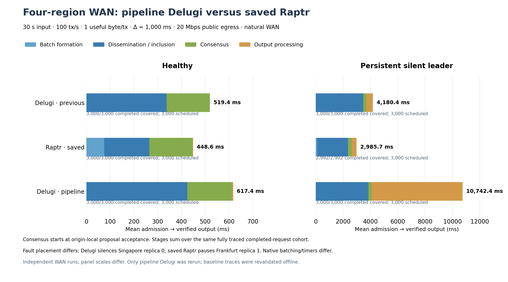

# Pipeline Delugi WAN rerun and comparison with Raptr

Both modified Delugi cases completed **3,000/3,000** requests, with matching
correct-replica output and complete latency traces. **Transaction latency
regressed in this WAN run**, despite faster proposal production. Healthy mean
latency is **617.37 ms**, versus 519.40 ms for previous Delugi and 448.58 ms for
saved Raptr. With a persistently silent leader, the mean is **10,742.39 ms**,
versus 4,180.45 ms and 2,985.65 ms respectively.

Only Delugi was executed again. There were exactly two successful input
workloads: healthy and silent-first-leader, each **30 seconds at 100 honest
tx/s**. An earlier startup attempt rejected all four load commands before any
input. Its logs remain separate; it contributes no benchmark observation.

## Deployment and coverage

The preset retains one `ecs.g9i.xlarge` in each of Singapore, Frankfurt, London
and Seoul, four CPUs/16 GiB RAM and a 200 GiB disk per host, one useful byte per
transaction, Δ=1,000 ms, natural WAN over WireGuard and 20 Mbps public egress.
Input has no warmup and at most 15 seconds of drain. Delugi retains 10 ms / 128
transaction batching. The modified protocol uses immediate canonical PROG,
pipeline REPORT preparation and immediate ordering bundling.

The executable was built from `59daec8`. A controller-only correction in
`20f4d64` maps a shared future monotonic epoch into each server's wall clock;
the same Linux executable and original build receipt were repacked with the
updated Python controller. No consensus code changed during the deployment.
The [record](record.json) binds the binaries, controller archives, both fleet
attempts, cleanup and costs; [parameters](parameters.json) freeze the preset.

Local validation passed 28 Rust checks and five Linux-supervisor checks before
the clock correction, followed by 28 Python clock/harness checks. Both fleets
have been deleted, including all eight instances and their security groups.
Their combined quote-based estimate is **¥19.33** (¥13.15 for the initial
build/startup fleet and ¥6.17 for the retry); final billing remains pending.

| Case | Protocol | Completed / scheduled | Window goodput, tx/s | Scheduled → output p50 / p95, ms |
|---|---|---:|---:|---:|
| Healthy | Previous Delugi | 3,000 / 3,000 | 98.23 | 518.83 / 668.17 |
| Healthy | Saved Raptr | 3,000 / 3,000 | 98.50 | 445.80 / 595.43 |
| Healthy | Pipeline Delugi | **3,000 / 3,000** | **97.93** | **612.71 / 800.75** |
| Silent leader | Previous Delugi | 3,000 / 3,000 | 93.03 | 4,250.20 / 7,248.25 |
| Silent leader | Saved Raptr | 2,992 / 3,000 | 82.53 | 2,971.28 / 5,291.94 |
| Silent leader | Pipeline Delugi | **3,000 / 3,000** | **65.70** | **10,880.52 / 13,874.66** |

All new requests were admitted and completed, with full stage coverage and zero
dropped trace events. Goodput counts only output inside the 30-second input
window; drain completions do not receive throughput credit. Saved Raptr's eight
silent-case requests were cancelled before admission. They remain in its
scheduled-cohort statistics, but cannot enter completed-request stage means.

## Latency decomposition

All means below are **milliseconds** from successful origin-local admission to
verified contiguous application output, before diagnostic journaling. Each row
uses one completed, fully traced request cohort and its stages sum to its total.
The middle boundary is **origin-local verified proposal acceptance**. Proposal
transit is included in dissemination/inclusion; these consensus spans are not
leader-broadcast-to-quorum measurements.

| Case | Protocol | Batching | Dissemination / inclusion | Consensus | Output processing | Total |
|---|---|---:|---:|---:|---:|---:|
| Healthy | Previous Delugi | 0.63 | 336.21 | 182.44 | 0.12 | 519.40 |
| Healthy | Saved Raptr | 74.67 | 190.54 | 180.87 | 2.50 | 448.58 |
| Healthy | Pipeline Delugi | **0.64** | **424.00** | **187.55** | **5.18** | **617.37** |
| Silent leader | Previous Delugi | 0.66 | 3,472.68 | 242.20 | 464.91 | 4,180.45 |
| Silent leader | Saved Raptr | 89.63 | 2,268.63 | 275.47 | 351.93 | 2,985.65 |
| Silent leader | Pipeline Delugi | **0.63** | **3,847.90** | **236.82** | **6,657.05** | **10,742.39** |



Relative to saved Raptr, pipeline Delugi is **37.6% slower healthy** and
**3.60× as slow under persistent silence** in these observed runs. Relative to
previous Delugi, the increases are **18.9%** and **2.57×**. The panel scales
differ so that the healthy breakdown remains visible.

## Healthy: faster proposals did not produce fresher inclusion

The complete leader-proposal streams show normalized cadence improving from
**145.59 to 105.55 ms per round**, about 27.5%. This divides successive proposals
on one leader's clock by their round gap; it does not claim every pair of
adjacent proposals is equally spaced on asymmetric WAN links.

The transaction regression is concentrated before proposal acceptance:
**336.21→424.00 ms**, an 87.80 ms increase. Agreement changes only
182.44→187.55 ms. The four observed ring RTT medians are similar to the prior
run: Singapore–Frankfurt 159.32 ms, Frankfurt–London 14.07 ms,
London–Seoul 239.26 ms and Seoul–Singapore 62.42 ms. They are not a complete
all-pairs or per-message network record.

At the Singapore and Frankfurt leaders, inputs now remain fixed for about
**96 ms before proposal emission while HISTORY3 catches up**; the corresponding
old waits were below 1 ms. Singapore round 65 is a direct same-clock example:
input fixes at 9,956.463 ms, HISTORY3 quorum arrives at 10,054.280 ms, and the
proposal leaves at 10,054.568 ms. The immutable input therefore waits 98.105 ms.
First execution also shifts toward London-led rounds: 1,849/3,000 requests,
compared with 908/3,000 previously. Most pre-proposal regression is borne by
Asian origins.

These observations demonstrate changed snapshot/inclusion timing. The leader
statistics and same-origin transaction subsets are different populations, so
they do **not** allocate the whole 87.80 ms aggregate increase. The
[healthy audit](healthy-pipeline-audit.md) retains exact joins and limitations.
Every observed healthy main/catch-up timer callback came after its own CER and
local classification, and there were **zero NoCER outcomes**. The healthy
latency is not explained by waiting for Δ to expire.

## Persistent silence: the early third-anchor snapshot misses new arrivals

Of the 6,561.94 ms increase over previous Delugi, **6,193.05 ms (94.4%)** is
additional contiguous-prefix waiting. The mean prefix stage grows from
462.06 to **6,655.11 ms**; payload and application work account for only the
remaining 1.94 ms of the new output bar.

The third honest anchor prepares an immutable input early, then waits for
HISTORY3 after the silent predecessor times out. Requests arriving during that
wait cannot enter the already fixed input. They enter the next cycle's first
honest anchor, commit, and wait behind the **next** silent leader before the
scanner can release them. In the new WAN cohort, **2,811/3,000** requests execute
in first-anchor rounds, with 7,088.34 ms mean prefix waiting. Only 183 execute
in third anchors. Previously, 2,788/3,000 executed in third anchors and could be
released at that recovery boundary.

One retained request on replica 3 makes the chain explicit. Input 12 fixes at
17,493.923 ms; the request is admitted at 19,823.828 ms; proposal 12 leaves only
at 24,239.951 ms. The request instead executes in round 14, is classified at
24,622.876 ms, and waits until 31,485.651 ms for contiguous release after the
next silent round. All these timestamps share one monotonic clock. Its total
latency is 11,664.653 ms, including 6,862.775 ms of prefix waiting.

The [silent-leader audit](silent-leader-audit.md) records the exact request,
snapshot and quorum evidence. Bounded lookahead limits the number of speculative
inputs, but does not bound their elapsed age during a timeout. Thus the pipeline
passes safety/output checks while this preparation policy worsens transaction
freshness and recovery latency. Refreshing a fixed input would require a
separate composition change; no such change was made in this rerun.

## Measurement and preserved differences

- Both protocols end at origin-local verified contiguous output before
  diagnostic journaling; they start at successful origin-local admission.
  The common middle boundary remains local proposal acceptance;
  these saved traces cannot be relabeled as the requested first-leader-emission
  transaction boundary.
- Detailed Delugi handler spans retain the configured sampling of eight rounds
  per 64 and a 250,000-event cap. Request-boundary markers and proposal cadence
  are retained across the run. Every completed request has all required stage
  markers. The separate leader diagnostics report their own sample counts and
  are not additive transaction-weighted stages.
- The initial controller wall-time assumption failed because remote clocks were
  about 2.1 seconds ahead. The retry used common-monotonic scheduling with leads
  of 2.126/2.117 seconds for healthy/silent. Measured pairwise start uncertainty
  bounds are 473/468 ms. This changes setup synchronization, not the 30-second
  per-origin input schedule or latency endpoint. The controller fix passed
  28 clock/harness checks; replica code and binary were unchanged.
- Raptr retains native Quorum Store batching: 150 ms polling, 80 ms minimum
  nonempty interval and 300 ms maximum. Delugi retains a 10 ms batch wait.
  Common overrides were unset.
- Equal Δ does not equalize native recovery timers: Raptr uses 4Δ from round
  entry; Delugi keeps its eligible **7Δ main timer and 3Δ catch-up timer**.
  Reversed legacy adapter labels are not the core timer semantics.
- Delugi silences replica 0 in Singapore, with transport ACKs active; saved
  Raptr pauses replica 1 in Frankfurt. Both faults recur through that identity's
  leadership slots, with no reintegration. Different placements/mechanisms and
  independent WAN executions limit causal comparisons between protocols.

This is one run per case at one low offered load, with unquantified observer
overhead. It validates deployment and exposes a latency regression; it does
not support a claim of Delugi performance superiority.

## Reproduce from retained evidence

Raw new evidence is under
`benchmark/.state/runs/delugi-pipeline-wan-20261029-clock-aligned`, with healthy
trial `b02e64f55f4e7fa0598860f6` and silent trial `d22bcc884402d1e925c4eed8`.
The failed pre-input attempt remains under `delugi-pipeline-wan-20261029`.
Raptr is reused from `raptr-wan-stages-20261029`; previous Delugi is reused from
`delugi-raptr-wan-30s-20261028`. Baseline result hashes and published reductions
are checked before creating the new comparison.

```sh
MPLCONFIGDIR=/private/tmp/delugi-mpl \
benchmarks/.cache/aliyun-python/bin/python \
  benchmarks/results/delugi-pipeline-wan-2026-10-29/plot_comparison.py \
  --run benchmark/.state/runs/delugi-pipeline-wan-20261029-clock-aligned \
  --output benchmarks/results/delugi-pipeline-wan-2026-10-29
```

The command only reads local evidence. It rechecks result/cohort/trace hashes,
run identity, exact preset, pipeline policy, authentication results and complete
stage coverage, then regenerates [comparison JSON](comparison.json),
[stage CSV](common-stages.csv), the [PDF](latency-decomposition-comparison.pdf)
and [SVG](latency-decomposition-comparison.svg). Full new native-stage reductions
are retained for [healthy](delugi-healthy-decomposition.json) and
[silent](delugi-silent-first-leader-decomposition.json) cases.
