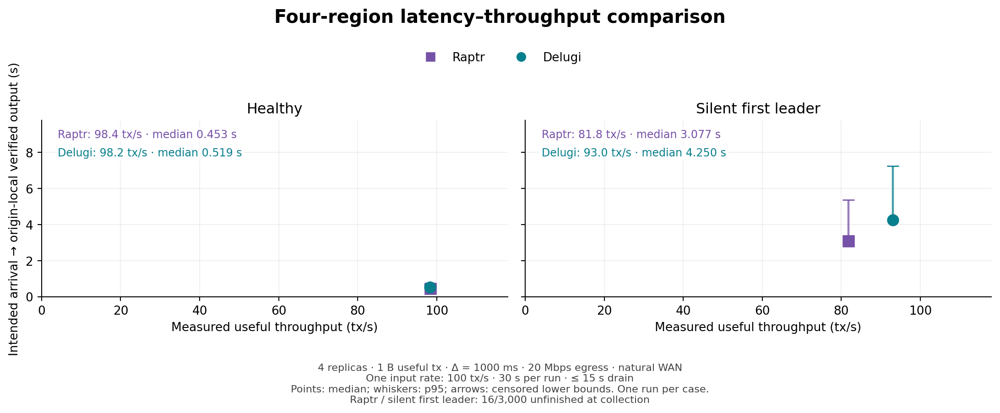
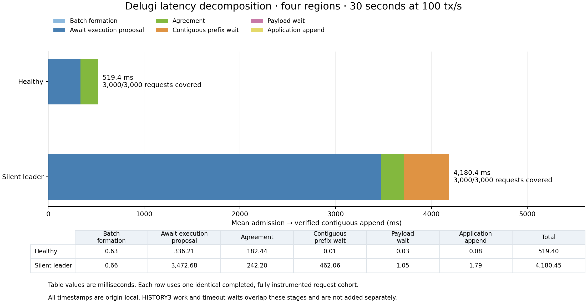

# Modified Delugi/Raptr four-region verification

On 28 October 2026, common Linux release `cef4e2213c734fd208d3ae99b5a0a7a41b80f591`
ran exactly four workload trials through Fabric: healthy and silent first leader
for Delugi and integrated Raptr. Each trial offered **100 tx/s for 30 seconds**,
with no warmup and at most 15 seconds of drain. There were no repeated workload
attempts. Setup and build recovery happened before any workload started.

The four `ecs.g9i.xlarge` hosts were in Singapore, Frankfurt, London and Seoul,
with 200 GiB disks, the saved 20 Mbps public-egress setting and an exact-peer
WireGuard overlay. Transactions contained one useful byte; Δ was 1,000 ms and
no synthetic delay was added. The measured ring RTTs were approximately
162, 14, 240 and 64 ms. This is natural WAN, not the earlier δ=10 ms local test.
The frozen [parameters](parameters.json) and [record](record.json) bind the
configuration, source, artifact hashes, checks and cleanup.

| Protocol | Case | Scheduled / admitted / completed | Window goodput (tx/s) | End-to-end p50 (ms) | p95 (ms) | TCP writes in window (bytes) |
|---|---|---:|---:|---:|---:|---:|
| Raptr | Healthy | 3,000 / 3,000 / 3,000 | 98.37 | 453.322 | 612.193 | 15,961,193 |
| Delugi | Healthy | 3,000 / 3,000 / 3,000 | 98.23 | 518.833 | 668.166 | 27,716,299 |
| Raptr | Silent leader | 3,000 / 2,984 / 2,984 | 81.80 | 3,076.608 | 5,380.256 | 40,937,339 |
| Delugi | Silent leader | 3,000 / 3,000 / 3,000 | 93.03 | 4,250.197 | 7,248.252 | 7,439,939 |

Latency starts at scheduled arrival and ends at the origin's payload-verified
contiguous append, using its monotonic clock. Goodput counts completions inside
the exact 30-second window; drain completions receive no throughput credit.
Traffic counts successful replica TCP writes, excluding build/SSH/log transfers
and lower-layer retransmissions. It is not a provider billing counter.

All execution, authentication and agreement checks passed. Raptr cancelled 14
London-origin and two Seoul-origin requests before admission at the finite cutoff.
All admitted requests completed; all three honest replicas agreed on 2,984 useful
outputs. The 16 uncompleted scheduled requests remain in the end-to-end population,
including the [CSV](summary.csv), [JSON](summary.json) and comparison plot.

## Delugi stage accounting

Both cases have **3,000/3,000 requests covered**, zero exclusions and zero dropped
trace events. The six stage means use one identical cohort and sum exactly to
mean admission-to-append latency. Scheduled-arrival-to-admission adds 0.044 ms in
the healthy case and 0.055 ms in the silent-leader case.

The silent-leader mean is **4,180.45 ms**: proposal waiting contributes
**3,472.68 ms**, agreement **242.20 ms**, and contiguous-prefix waiting
**462.06 ms**. Batch formation, payload waiting and append contribute the
remaining 3.51 ms. These are measured boundaries, not a sum of assumed network
delays or timer constants. The proposal boundary is full local validation;
proposal transit belongs to the preceding wait stage.

Leader-local logical PROPOSE emission to direct CER-quorum decision averaged
203.89 ms healthy and 247.51 ms with the silent leader. Frozen-input age averaged
0.298/0.270 ms, with maxima 0.413/0.471 ms. Fresh REPORT preparation therefore
avoids the old stale-input accumulation in this run. The honest fault-case nodes
still reached admission round 39 and delivery round 20: recurring 7Δ recovery
and the admission/delivery round gap remain. Fifteen `no_cer` events represent
five silent-leader rounds across three honest replicas. Healthy traces contain
no `no_cer` events; timer-expiry callbacks for already-decided rounds must not be
mistaken for actual request delay.

Separate, overlapping HISTORY3 diagnostics are retained in
[the decomposition summary](decomposition-summary.json) and the two full
[healthy](decomposition-healthy.json) / [silent](decomposition-silent-first-leader.json)
reports. Report generation averaged 0.087/0.097 ms; first report receipt to quorum
averaged 93.76/165.63 ms. Individual encoded HISTORY3 messages were at most
2,532 bytes. The sampled assembled history objects were at most 3,119 bytes;
sampled assembly averaged 0.120/0.041 ms. Neither CPU assembly nor object size
accounts for the multi-second fault latency. These parallel leader spans are
not added to the transaction bars.

## Interpretation and retained evidence

At this one offered rate, Delugi had higher in-window fault-case goodput and
higher median latency than Raptr. One run per case supplies deployment and causal
evidence, not a capacity curve or repetition confidence interval. Delugi tracing
was enabled; its overhead has not been measured separately. The native fault
hooks also differ: Delugi silences replica 0 in Singapore while keeping transport
ACKs active; Raptr pauses replica 1 in Frankfurt before arm. The previous WAN
baseline lasted 60 seconds, so its before/after numbers are not a matched-duration
effect estimate.

The Linux release suite passed 24 tests. All 15 collected replica snapshots use
the configured 5,000 ms connect timeout, with zero rejected frames, queue-full
failures or resource exhaustions. No consensus or networking source changed in
this rerun. The `history_ready` composition schedule remains the recorded revision
to the pinned paper's REPORT trigger; this experiment does not prove the paper's
canonical timing bound.

All four instances and owned security groups were deleted. The quote-based fleet
cost estimate is **CNY 17.51**, including build/setup time; final provider billing
is not reconciled. The additional reservation was CNY 100, within the existing
budget, and unsettled reservations were retained. Remote build intermediates and
approximately 2 GiB of local intermediates were removed; executables, receipts
and raw logs were retained.

The local raw-log archive contains 356 files and has SHA-256
`de4c55bc4d8fcc7706f575efb68387632c121a35db2bfd9be08dc519d4144fd3`.
Its location is recorded in [record.json](record.json). Export versions:
[comparison PDF](latency-throughput-end_to_end.pdf),
[decomposition PDF](latency-decomposition.pdf),
[stage CSV](decomposition.csv), and
[admission-based comparison](latency-throughput-admission.pdf).
The paired figure can be recreated offline with
`python plot_decomposition.py` using the published reduction JSON files.
