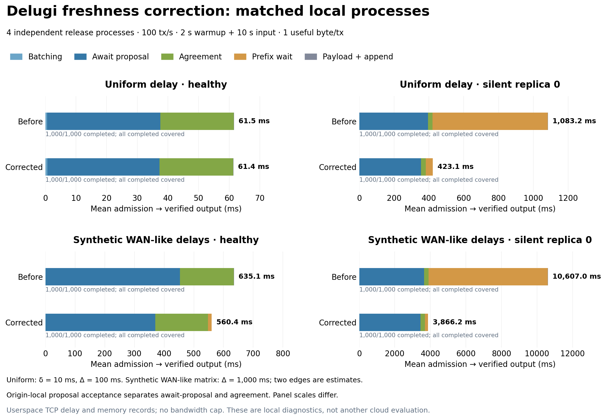

# Delugi input-freshness correction: matched local measurements

The previous REPORT guard froze an opportunity's input before its missing
predecessor resolved. Transactions arriving during a silent leader's timeout
therefore missed the third recovery anchor, entered the next cycle and waited
for another silent round to clear the output prefix. The corrected guard waits
for full validation of the predecessor before speculative preparation, while
retaining completed-prefix, CLOSED and exact-history recovery paths.

Eight matched local runs reproduce the regression and its correction. All
eight admitted, completed and fully decomposed **1,000/1,000** measurement-cohort
transactions; every correct replica ultimately collected all 1,000 outputs.

| Local delay model | Case | Mean total before → corrected (ms) | Mean prefix wait before → corrected (ms) | Output rate inside the 10 s window, before → corrected (tx/s) |
|---|---|---:|---:|---:|
| Uniform δ=10 ms, Δ=100 ms | Healthy | 61.54 → 61.36 | 0.009 → 0.010 | 99.9 → 100.1 |
| Uniform δ=10 ms, Δ=100 ms | Silent replica 0 | 1,083.18 → 423.13 | 661.29 → 40.73 | 100.1 → 100.1 |
| Synthetic WAN-like matrix, Δ=1,000 ms | Healthy | 635.09 → 560.38 | 0.026 → 12.62 | 101.0 → 99.7 |
| Synthetic WAN-like matrix, Δ=1,000 ms | Silent replica 0 | 10,607.02 → 3,866.22 | 6,704.82 → 170.04 | 0.0 → 63.2 |

Silent-case mean latency falls by 60.9% and 63.6%, primarily through removal of
the extra output-prefix wait. Healthy uniform latency is essentially unchanged.
Healthy synthetic WAN-like latency falls by 11.8%, mostly before proposal
acceptance. These are one paired run per configuration, without statistical
confidence intervals. They establish this regression under the tested loads,
not a throughput-capacity result or a new cloud result.

The window output rate counts unique origin-local outputs whose timestamps
fall inside the measurement window, including warmup requests carried into it.
It can slightly exceed the offered 100 tx/s. The old WAN-like silent run has
zero outputs in that window but completes its full cohort during drain; those
late completions remain in the latency means and are not reported as zero.



[PDF](latency-before-after.pdf) · [SVG](latency-before-after.svg) ·
[Exact stage means and cohort counts](stages.csv) ·
[Full verified reduction](comparison.json)

## Measurement boundaries

Each transaction contributes one sequence of timestamps from its **origin's
own monotonic clock**:

1. Local admission → exact batch sealed: batch formation.
2. Batch sealed → full validation of the proposal whose round releases that
   batch: await execution proposal, including dissemination, inclusion waiting
   and proposal transit.
3. Proposal validation → first final scanner commit classification: agreement.
4. Classification → contiguous prefix release: prefix wait.
5. Prefix release → verified payload ready: payload wait.
6. Payload ready → application output record: application append.

All six means use the same 1,000 completed and instrumented requests per run;
they sum exactly to admission → output. The figure combines the final two
small intervals. There are no missing-stage exclusions or unfinished requests.
Final output collection independently verifies matching correct-replica
prefixes and exact batch identities; it does not establish remote output
latency. No stage subtracts timestamps from different replicas.

In particular, the agreement bar starts **after local proposal acceptance**.
Its approximately 24 ms uniform healthy mean does not replace the complete
three-message-delay PROPOSE → direct-commit path. The latter is measured
separately on each proposing leader's clock below. Leader REPORT/input spans
overlap transaction stages and must not be stacked on top of them.

## Leader scheduling and cadence

| Delay model / case | Input fixed → PROPOSE, before → corrected (ms) | Leader PROPOSE → direct commit, before → corrected (ms) | Complete leader rounds in window, before / corrected | Normalized proposal cadence, before → corrected (ms/round) | Cadence intervals, before / corrected |
|---|---:|---:|---:|---:|---:|
| Uniform / healthy | 0.971 → 0.412 | 32.124 → 32.376 | 887 / 876 | 11.283 → 11.414 | 883 / 872 |
| Uniform / silent | 229.777 → 0.710 | 33.981 → 34.525 | 42 / 42 | 178.736 → 178.728 | 39 / 39 |
| WAN-like / healthy | 66.112 → 2.540 | 189.874 → 190.839 | 85 / 84 | 116.865 → 117.371 | 81 / 80 |
| WAN-like / silent | 2,332.928 → 0.440 | 248.622 → 245.144 | 3 / 3 | Insufficient within-window pairs | 0 / 0 |

Cadence uses successive proposals from the same leader, both inside that
leader's measurement window, divided by their round-number difference. It
avoids cross-replica clock subtraction. Silent-case cadence includes timeout
recovery; the ten-second WAN-like window contains too few own-leader pairs
for a cadence statistic. All leader detail markers are retained (`stride=1`).

The correction removes the long frozen-input interval without disrupting
healthy proposal cadence. Uniform process measurements retain approximately
one proposal per configured delay and approximately three delays from leader
PROPOSE to direct commitment, with local runtime/proxy overhead. In the
synthetic WAN-like run, mean REPORT → observation-pool completion is essentially
unchanged: 182.645 → 183.178 ms healthy and 241.189 → 243.080 ms silent. This is
a change to **when input preparation starts**, not a faster observation quorum.

Remaining latency is explicit. The corrected WAN-like healthy run still spends
369.14 ms awaiting its execution proposal, 177.50 ms in agreement and 12.62 ms
waiting for the prefix. The corrected silent run spends 3,447.08 ms awaiting
the proposal and 170.04 ms waiting for the prefix. Main and catch-up timers are
unchanged; requests arriving during a missing leader still encounter recovery.

## Corrected guard and bounded timing argument

The [pipeline design note](../../../docs/architecture/2026-10-29-pipeline.md)
records the exact guard, wakeups, typed send wave and assumptions. Beyond the
first three opportunities, a correct leader opens REPORT(k) when it has one of:

- Its own completed history through k−3.
- Its own completed history through k−4 **and a fully Q-validated proposal
  k−3**. Round 4 uses the completed genesis prefix plus valid proposal 1.
- At least f+1 authenticated CLOSED signatures for k−3.
- The exact n−f HISTORY3 reports required for proposal k.

Completion and proposal-validation events retry preparation in either arrival
order. A header, vote or one CER is insufficient. REPORT, signed observations,
the completed observation pool and input remain once-only and immutable.
Q, quorum sizes, classification, prefix release and timers are unchanged.

For a healthy uniform-delay execution, the completed k−4 history and validated
k−3 proposal arrive in the same productive wave. REPORT/OBS still take two
delays, proposals remain one delay apart, and leader PROPOSE → direct commit
takes three delays. With a silent predecessor, the third anchor prepares after
the predecessor resolves, allowing timeout-period arrivals into its input.

The CLOSED fallback preserves the original post-stabilization timer argument:
with earliest main-timer start t and δ<Δ, admission and the authenticated
fallback enable input by t+4δ; exact history is available by t+3Δ+2δ; all correct
replicas can emit CER by t+3Δ+4δ<t+7Δ. Future preparation remains bounded by
k≤C*+4, where C* is the greatest correct completed own-report prefix. This is
an argument under the documented protocol assumptions, not a machine-checked
proof or a general freshness bound. A Byzantine leader can still send a valid
proposal selectively and then stall.

Three passing signed-core regressions in
[`freshness_regression.rs`](../../../core/delugi/tests/freshness_regression.rs)
test the boundaries directly:

- `batches_arriving_during_silence_use_the_same_recovery_anchor`: batches
  arriving at 250 and 1,000 ms execute in third anchors 4 and 8. The first
  outputs at 790 ms after the fix, versus round 6 at 1,490 ms with the old
  guard (δ=10 ms, Δ=100 ms).
- `healthy_pipeline_keeps_delta_cadence_with_post_start_arrivals`: no preloaded
  payloads; four origins stream batches every seven milliseconds. Proposals
  5–24 are δ-spaced, direct commitment takes 3δ and every tested transaction
  reaches output within 7δ.
- `speculative_preparation_requires_full_exact_predecessor_validation`:
  incomplete evidence, invalid proposals and valid proposals from another
  round cannot unlock preparation; valid proposal 1 does, in both arrival
  orders relative to admission.

## Local configuration and reproducibility

Each run uses four independent production release processes, real signatures
and TCP, memory record storage, a 100 tx/s aggregate rate, one useful byte per
transaction (61 native encoded bytes), a 10 ms batching interval, at most 128
transactions per batch, two seconds of warmup, ten seconds of measured input
and up to fifteen seconds of drain. The silent case suppresses replica 0
throughout. Canonical immediate PROG, pipeline REPORT preparation and immediate
ordering-message bundling are enabled in both versions.

An unprivileged pipelined TCP proxy adds delays without per-frame ACK gating.
The uniform preset adds 10 ms per direction and sets Δ=100 ms. Idle calibration
measured 24.05 ms added median RTT, including userspace scheduling overhead.
There is no bandwidth cap or kernel network shaping. Every retained proxy
report passes delay, byte conservation, closed-connection, queue-capacity and
no-discard checks; those checks cover proxy read → forward, not full path RTT.

The synthetic matrix below sets Δ=1,000 ms. Rows and columns are Singapore,
Frankfurt, London and Seoul. Values are symmetric one-way delays in ms:

| | Singapore | Frankfurt | London | Seoul |
|---|---:|---:|---:|---:|
| Singapore | 0 | 80 | **85 estimated** | 31 |
| Frankfurt | 80 | 0 | 7 | **115 estimated** |
| London | **85 estimated** | 7 | 0 | 120 |
| Seoul | 31 | **115 estimated** | 120 | 0 |

The other four edges approximately halve previously measured ring RTTs. This
is a synthetic diagnostic topology, not an all-pairs WAN replay. All processes
share the local host, memory storage differs from the prior cloud RocksDB
configuration, and no Aliyun machines were provisioned or rerun for this check.

The retained [matched run index](../../../results/local/delugi-latency-debug-20261029/matched-index.json)
binds both executables, source manifests, controller files, per-run results and
decompositions. Before uses retained release executable SHA-256
`b96a379cf342cb6c03a159d08c69e4e343732d8c884c63ec867d520e7285b250`;
corrected uses
`f8a6cdcdd76fc8a9dcb889b15a0764c1eb804d5a525bb7f5c23d8911640d758c`.
The old executable is the source-bound local build of the previous guard, not
the Linux executable from the WAN experiment.

Runtime correction commit: `8d84dec`. The full Rust workspace check passed
276 tests, with zero failures and 20 ignored; the five relevant Python suites
passed all 58 tests. [record.json](record.json) binds the source audit, test
outputs, retained evidence and build-cache cleanup.

[`plot_results.py`](plot_results.py) verifies all eight cells and their fixed
parameters, file hashes, complete unsampled traces, authenticated cohort/shard
bindings, correct output-prefix agreement, proxy invariants and every emitted
REPORT's version-specific guard. It independently recomputes each transaction
decomposition and checks equality with the frozen per-run reduction before
writing this figure. Regenerate from the repository root after the retained
local runs have finished:

```sh
MPLCONFIGDIR=/private/tmp/delugi-freshness-mpl \
  benchmarks/.cache/aliyun-python/bin/python \
  benchmarks/results/freshness-fix-2026-10-29/plot_results.py \
  --index results/local/delugi-latency-debug-20261029/matched-index.json \
  --output benchmarks/results/freshness-fix-2026-10-29
```

Raw local artifacts remain under `results/local/delugi-latency-debug-20261029`;
the committed reduction retains their hashes and numerical results. The
short before/after measurements diagnose this scheduling error. A later
authorized WAN run is still needed to measure its effect on remote machines.
