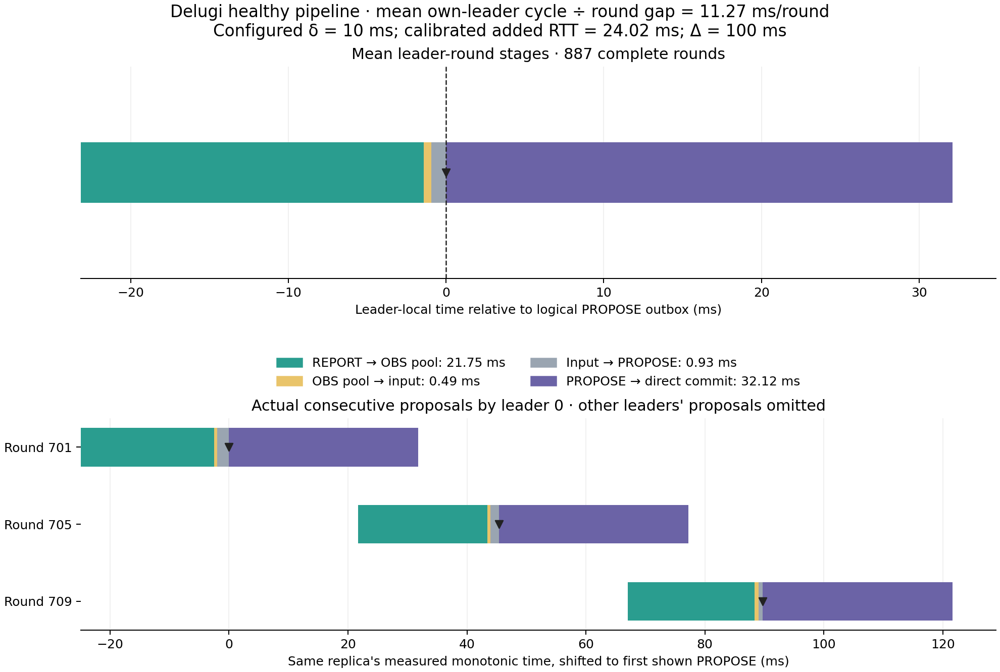
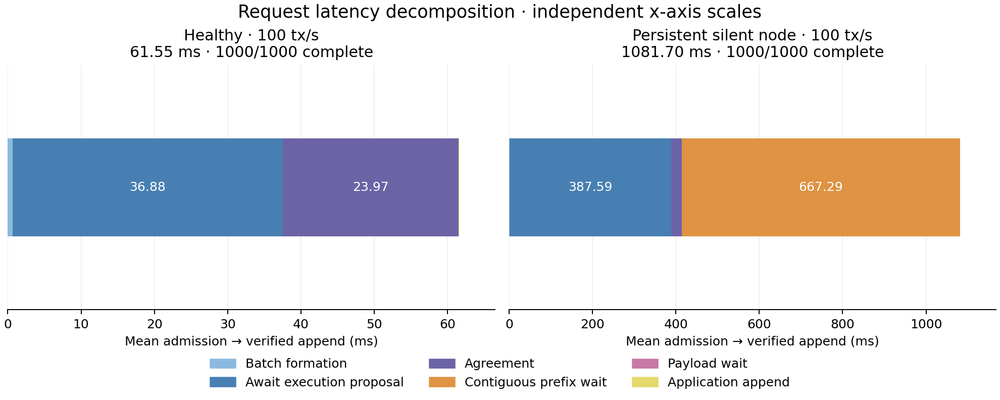

# Corrected Delugi pipeline: signed-core proof and delayed-TCP validation

The corrected default emits one proposal per δ in the constant-delay signed-core
regression. Four independent TCP processes sustain approximately **11.27 ms per
round** with a configured 10 ms one-way delay and Δ=100 ms. Healthy admission to
verified output averages **61.55 ms at 100 tx/s** and **65.98 ms at 4,000 tx/s**.

Implementation: `360d9f7`, committed and pushed before the process runs. See the
[complete guard/send matrix and timing argument](../../../docs/architecture/2026-10-29-pipeline.md)
and [actual signed-core regression](../../../core/delugi/tests/pipeline_composition.rs).

## What changed

Canonical PROG is immediate again. An admitted leader prepares REPORT(`k`) once
when `k<=4`, its own completed outcome prefix reaches `k-4`, or authenticated
CLOSED/history evidence justifies preparation. This opens REPORT(`r+2`) at the
boundary producing proposal `r`, with OBS(`r+1`) and the enabled ordering sends
in the same logical wave. Preparation no longer waits for the target
proposal's complete HISTORY3 quorum.

The guard bounds prepared opportunities by the greatest correct completed
outcome prefix plus four. Admission remains independent, including during
faults. Signature checks, immutable bases/observations/pools/inputs, Q, typed
quorums, once-only sends, scanner logic and `7Δ`/`3Δ` timers remain unchanged.
The input-readiness bound starts at this evidence trigger, rather than arbitrary
early admission. This composition change is documented separately from the
historical pinned paper sources.

## Correctness evidence

The production signed-core fixture tests twelve healthy rounds with fresh
streamed payloads, exact one-δ proposal spacing and three-δ direct commitment.
For each measured healthy boundary it checks PROPOSE, VOTE, CER, HISTORY3,
CLOSED, PROG, OBS and REPORT, their recipients, distinct typed quorum evidence,
and once-only sends. It explicitly handles immediate own-leader voting and
self-observation. Every generated request is delivered in identical order.

It also tests repeated silent leadership at rounds 1/5/9, all three honest
anchor triples, late streamed batches, recovery at δ=99 ms/Δ=100 ms through
round 12, valid Byzantine forks and rejection of signed cross-branch grafts.
The CLOSED fallback rejects forged signatures, duplicate signers and wrong
horizons, and opens REPORT only once after the exact threshold.

Validation: **273 workspace tests passed**, 20 explicitly ignored. The final
five pipeline integration tests were rerun after extending the near-bound test
and adding recipient assertions. Relevant Python runner, provenance, adapter,
conformance, delay-proxy and measurement tests passed **133 checks**. The
analysis checks independently reject mismatched commit digests, cross-clock
arithmetic, duplicate quorum signers and confusing window completions with
final cohort completions.

## Independent-process measurements

Each sustained run used four local replica processes, real signatures and TCP,
canonical ordering, pipeline preparation, immediate ordering bundling,
δ=10 ms, Δ=100 ms, 2 s warmup, 10 s measurement and up to 15 s drain.
Transactions contain one useful byte, **61 bytes in the native encoding**.
Batching has a 10 ms limit and a 128-transaction cap. Storage is in memory.
The silent case disables replica 0 throughout, so its leadership is missing
every fourth round. It is not a one-time omission.

| Case | Completed intended cohort | Window throughput | Mean cadence per round | Mean leader PROPOSE → direct commit | Mean admission → verified output |
|---|---:|---:|---:|---:|---:|
| Healthy, 100 tx/s | 1,000/1,000 | 100.0 tx/s | 11.274 ms | 32.124 ms | 61.547 ms |
| Healthy, 4,000 tx/s | 40,000/40,000 | 4,000.3 tx/s | 11.270 ms | 31.916 ms | 65.979 ms |
| Persistent silent replica, 100 tx/s | 1,000/1,000 | 99.8 tx/s | 178.143 ms, including recovery | 32.946 ms | 1,081.705 ms |

Cadence uses successive proposals by the **same leader**, divided by their
round-number gap (four). No latency subtracts timestamps from different
replicas. The healthy estimates contain 883 intervals and 887 complete leader
rounds each; the silent estimate contains 39 intervals and 42 leader rounds.
Every correct replica agrees on the collected output prefix. Every intended
request completed after drain, with zero trace drops or excluded stage joins.
Finite TCP checks separately passed healthy round 4 and a silent leader followed
by three honest anchors.

Pending requests stayed at **6→6** in the 100 tx/s healthy window and **279→276**
at 4,000 tx/s. The silent window has 998 completions, including carried-in work;
its final intended cohort nevertheless completed **1,000/1,000**. Including
warmup, all 1,200 requests completed on every correct replica. Its pending
count oscillates with recovery and ends at 81 versus 79 at the start.

## The preparation pipeline is visible in the traces

| Mean same-leader stage | Healthy 100 tx/s | Healthy 4,000 tx/s | Persistent silent 100 tx/s |
|---|---:|---:|---:|
| REPORT → fixed OBS pool | 21.753 ms | 21.722 ms | 23.954 ms |
| Fixed pool → fixed input | 0.492 ms | 0.605 ms | 0.897 ms |
| Fixed input → PROPOSE outbox | 0.925 ms | 0.973 ms | 229.552 ms |
| PROPOSE outbox → direct CER commitment | 32.124 ms | 31.916 ms | 32.946 ms |

All 887 healthy measured REPORTs start **before** their target HISTORY3 quorum.
The two-delay reporting exchange overlaps the preceding proposals. Healthy
input-to-proposal waiting is below 1 ms on average; it no longer serializes an
extra reporting exchange behind HISTORY3. At 4,000 tx/s, batching increases
from 0.656 to 5.047 ms on average and explains most of the small increase in
transaction latency.



The top panel uses identical complete leader-round populations. The lower
panel shows three actual consecutive proposals by leader 0; other leaders'
intervening proposals are omitted to keep one monotonic clock. These stage
means are round weighted and must not be summed or compared as if they were
transaction-weighted means.

The fault case still commits honest proposals in approximately 33 ms, but
request output waits for a contiguous decided prefix. Its mean transaction
latency contains **667.291 ms of prefix waiting** and **387.592 ms awaiting the
execution proposal**. Recovery therefore explains its high output latency.
614 of its 1,000 intended requests miss the configured 1 s deadline, although
all eventually complete. Healthy traces contain zero NoCER outcomes; elapsed
timer notices for already-terminal rounds are not recovery delays.



This existing request decomposition splits at proposal **acceptance at the
origin**. Its agreement stage (23.972 ms in the healthy run) is consequently
shorter than the leader's 32.124 ms PROPOSE-outbox-to-CER span. These are distinct
boundaries. The requested first-leader-proposal split for a formal Delugi/Raptr
transaction comparison still needs exact common membership instrumentation.

## Emulated network and measurement scope

The unprivileged proxy delays each TCP byte-stream chunk independently in both
directions. Its reader and writer run concurrently; no frame/ACK round-trip gate
is introduced. This is userspace stream delay, not kernel packet shaping.
Connections are established normally, there is no bandwidth cap, and CPU/OS
scheduling adds overhead. Controls bypass the proxy.

The healthy 100 tx/s run's actual forward hold averages **10.216 ms** (maximum
13.546 ms). Its idle calibration adds **24.025 ms RTT**. These observations
describe different scheduling conditions; neither is silently treated as an
exact end-to-end one-way delay. Every proxy reports zero discarded bytes and
zero queue-capacity waits. Traffic is measured once at replica sockets,
including signed framing and ACKs, excluding duplicate proxy writes and TCP/IP
headers. Full per-run counts are in `run-index.json`.

These local runs demonstrate pipeline formation and finite recovery. They are
not WAN performance claims or measurements for larger payloads/committees.

## Reproduction and retained evidence

The same source-bound release binary was used for all runs:
`b96a379cf342cb6c03a159d08c69e4e343732d8c884c63ec867d520e7285b250`.
The manifest archives the modular source closure and exact selected historical
specification. The live paper differs from its pin, so the explicit archived
paper path is used. A first build preflight stopped at that mismatch, and a
first process preflight stopped at local socket permission; neither launched
a workload. No remote deployment was performed.

```sh
cargo test --workspace --offline --locked
python3 scripts/run_sustained.py --build-only \
  --spec-snapshot provenance/spec-2026-10-19.json \
  --paper-repository results/local/migration-acceptance-n4-ablation-progress-bundled-20261019/snapshot/paper \
  --output results/local/pipeline-build-reproduction
python3 scripts/run_tcp_delay.py \
  --spec-snapshot provenance/spec-2026-10-19.json \
  --paper-repository results/local/migration-acceptance-n4-ablation-progress-bundled-20261019/snapshot/paper \
  --output results/local/pipeline-healthy-reproduction --scenario all \
  --delay-ms 10 --bound-ms 100 --rate 100 --transaction-size 61 \
  --ingress-batch-ms 10 --warmup 2 --duration 10 --drain 15 \
  --causal-trace --trace-stride 1 --trace-max-events 500000 \
  --ordering-mode canonical --report-schedule pipeline
```

For the other two sustained cases, select `--scenario sustained` and either
`--rate 4000` or `--silent-first-leader`, using a fresh output directory.
`scripts/analyze_pipeline.py --healthy <healthy-run> --silent <silent-run>
--output <analysis-directory>` validates saved hashes, run bindings, exact
cohorts, instrumented typed guards and same-clock spans without rerunning nodes.
Its `analyze_run` function also produces the retained 4,000 tx/s summary.

Raw manifests, signed receipts, cohort shards, snapshots, causal traces and
source archives remain under `results/local/pipeline-tcp-20261029-{healthy-run,silent,4000}`.
Compact [healthy/silent results](summary.json), [4,000 tx/s results](fourk-summary.json),
[run identities and commands](run-index.json), and the PNG/PDF figures are
committed here. The analysis-source hash is included in the summaries.

After validation, 494 MB of generated build intermediates were removed. The
verified release executable, its matching source stamp and all run evidence
remain available; the root `target` directory is approximately 9.5 MiB.
