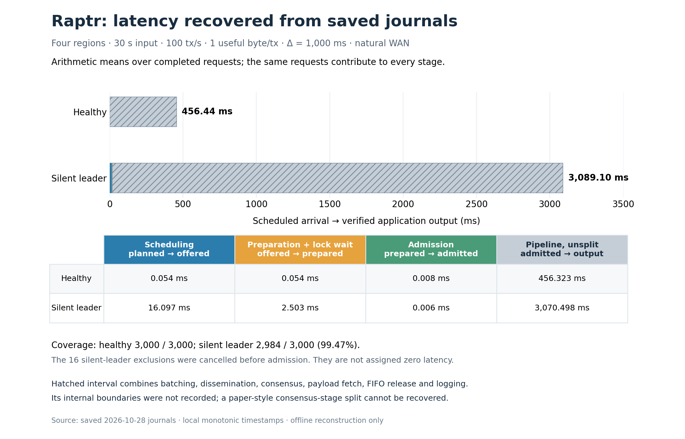

# Raptr latency decomposition from saved journals

Offline analysis of the two Raptr trials from the 2026-10-28 four-region campaign. No benchmark was rerun and no protocol implementation changed.



The saved journals support the following **partial decomposition**. Each cell is an arithmetic mean over the same completed-request cohort within that case, pooled across correct origins. The stages add to the total; independently computed percentiles would not.

| Recorded interval | Healthy (ms) | Silent leader (ms) |
| --- | ---: | ---: |
| Scheduled arrival → offered | 0.054 | 16.097 |
| Offered → prepared (lookup and mutex wait) | 0.054 | 2.503 |
| Prepared → admitted (successful enqueue) | 0.008 | 0.006 |
| Admitted → verified application output, combined | 456.323 | 3070.498 |
| **Scheduled arrival → output, mean** | **456.439** | **3089.104** |

Healthy includes 3,000 of 3,000 scheduled requests. Silent leader includes 2,984 of 3,000 (99.47%): the remaining 16 were cancelled before admission, and all admitted requests completed. The plotted means exclude those 16; they are not a full scheduled-cohort latency estimate. Previously published scheduled-cohort quantiles, including their censoring status, are preserved separately in `decomposition.json`.

The experiments used four regions (Singapore, Frankfurt, London and Seoul), 30 seconds of input, 100 honest tx/s, 1 useful payload byte per transaction, configured Δ = 1,000 ms, 20 Mbps public-egress caps, and natural WAN latency without added delay. The silent case paused Raptr replica 1 in Frankfurt. Native signed transaction and network sizes exceed the 1 useful byte.

## What remains unmeasured

The final interval contains batching, dissemination, proposal/inclusion, consensus, native payload fetch and verification, FIFO release, output-consumer scheduling, and journal construction. It cannot be labeled consensus latency or split further from these archives:

- `own_batch_ready_us` is null for every request; no proposal or consensus-commit timestamp is recorded per request.
- The native commit callback records counters, while its notification timestamp is discarded.
- Output sections record their final append timestamp, but not the preceding payload/FIFO/logging boundaries.
- Aggregate operation durations overlap and span requests; they cannot supply missing additive stages.

Timestamp meanings are implemented in [the workload observer](../../../core/raptr/node/src/workload.rs) (`start`, `admit`, `publish`, `native_commit`), [the native commit sink](../../../core/raptr/node/src/dissemination.rs), and [the materializer](../../../core/raptr/node/src/output.rs). Offered → prepared includes transaction lookup and waiting for the workload mutex. The output timestamp is sampled after journal construction/serialization, just before inserting the output entry; this logging overhead remains inside the large combined interval.

All differences use the originating replica's monotonic clock. No cross-host or wall-clock subtraction is used. In particular, native batch nonce and expiration fields cannot provide the missing boundaries.

This reconstruction does not resolve the previously identified Delugi/Raptr endpoint instrumentation asymmetry or differences in fault location/method. It reports only Raptr's saved measurements.

## Provenance and reproduction

- Healthy trial: `9b65f5c790b85b8186317c0f`.
- Silent-leader trial: `e29fe2ddd0dc409b444f0af8`.
- Source journals: `benchmark/.state/runs/delugi-raptr-wan-30s-20261028/trials/` (local, untracked).
- Source results: [published campaign summary](../fabric-wan-30s-2026-10-28/summary.json).
- Numeric results, exact stage sums, exclusions and source-file hashes: [decomposition.json](decomposition.json).
- Editable vector figure: [SVG](raptr-latency-decomposition.svg).

`reconstruct.py` checks result hashes against both saved campaign state and the published summary; checks journal hashes against the saved, previously verified signed-receipt descriptors; and matches every completed request to its credited output event and exact timestamp. It checks timestamp completeness, ordering, additive sums and population counts. Signatures are not reverified by this offline script.

From the repository root, with the existing local archives and plotting environment:

```sh
MPLCONFIGDIR=/private/tmp/delugi-mpl-20261028 benchmarks/.cache/aliyun-python/bin/python benchmarks/results/raptr-offline-decomposition-2026-10-29/reconstruct.py
```

This command only reads local evidence and writes the JSON, PNG and SVG in this directory. It never launches a replica or connects to a cloud host.
