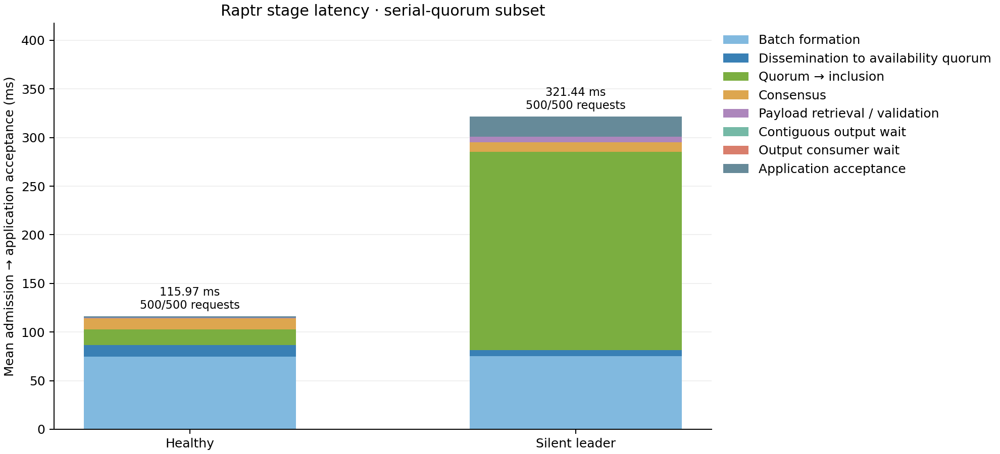

# Raptr timing instrumentation: local validation

Raptr now records exact-batch storage and availability-quorum times, verified proposal acceptance, exact commit-slice decisions, payload validation and FIFO release. Its application timestamp now precedes diagnostic BCS/JSON construction, matching Delugi's semantic endpoint: verified, contiguous application output. Protocol decisions, quorum rules and timers are unchanged.

Four independent local processes were used for each run: 100 honest tx/s, 1 useful byte per transaction, 5 seconds of input, 3 seconds of drain, Δ = 100 ms, and loopback networking without injected delay. Both protocols used the same unoptimized common executable and shared RocksDB profile. These are instrumentation/correctness checks, not WAN or release-performance measurements. No Aliyun operation was performed.

| Protocol / case | Completed | Full stage coverage | Dropped trace events |
| --- | ---: | ---: | ---: |
| Raptr healthy | 500 / 500 | 500 / 500 | 0 |
| Raptr silent leader | 500 / 500 | 500 / 500 | 0 |
| Delugi healthy | 500 / 500 | 500 / 500 | 0 |
| Delugi silent leader | 500 / 500 | 500 / 500 | 0 |

All correct replicas progressed beyond round 4. Signed archive verification, common output-prefix agreement, exact timestamp/event joins, nonnegative stage intervals and additive sums passed. Raptr's silent case pauses replica 1; Delugi's existing hook suppresses replica 0's protocol participation. These fault mechanisms remain distinct.



All 500 requests in each Raptr run also had availability quorum before execution-proposal acceptance, so the optional quorum split covers the complete cohort here. For other traces, late or absent quorums are explicitly excluded from that optional split while retaining their primary decomposition. This does not add a quorum-before-proposal gate to Raptr.

| Raptr mean stage (ms) | Healthy | Silent leader |
| --- | ---: | ---: |
| Batch formation | 74.844 | 75.287 |
| Stored batch → availability quorum | 11.538 | 6.014 |
| Quorum → execution proposal | 16.207 | 204.256 |
| Consensus | 11.663 | 9.828 |
| Output processing, combined | 1.714 | 26.052 |
| **Admission → application acceptance** | **115.967** | **321.438** |

Output processing includes native payload retrieval/validation, contiguous FIFO wait, consumer scheduling/mutex wait and application identity/deduplication checks. Diagnostic journal construction occurs afterward: its completed-request-weighted mean was 0.261 ms healthy and 4.012 ms silent. This is construction/size-serialization time, not full journal write time or total observer interference. Journaling can still affect later work through scheduling or lock contention.

Validation also passed **41 Rust tests** (28 native node/archive tests and 13 recorder/output-contract tests) and **135 Python tests**, including hash mutation, exact fork/section identity, missing/nonsequential stages, trace overflow, endpoint deadlines, pre-admission replay, duplicate credit, output capacity failure, configuration forwarding and legacy archives. The real `fab decompose --protocol=raptr` command reconstructed all 500 healthy requests offline.

Evidence: [validation record](record.json), [Python test record](python-tests.json), [healthy Raptr stages](raptr-healthy-decomposition.json), [silent Raptr stages](raptr-silent-decomposition.json), [healthy Delugi stages](delugi-healthy-decomposition.json), and [silent Delugi stages](delugi-silent-decomposition.json). Original signed journals, exact build receipts and full Delugi round diagnostics remain under the local paths recorded in these files. [Stage definitions](../../../docs/evaluation/latency-decomposition.md) explain the endpoint version and overlap accounting. The 28 October WAN results retain their original timestamps.

Enable future Raptr tracing in the shared parameter file under `node.protocol_options.raptr`:

```json
{"latency_trace": {"max_events": 100000}}
```

After logs have been downloaded, from `benchmark/`:

```sh
fab decompose --protocol=raptr \
  --config=../results/local/raptr-timestamps-20261029-healthy/config.json \
  --replicas=../results/local/raptr-timestamps-20261029-healthy/replicas \
  --verification=../results/local/raptr-timestamps-20261029-healthy/manifest.json \
  --output=../results/local/raptr-timing-figure
```

This command only reads local evidence and writes a JSON report and PNG figure.
