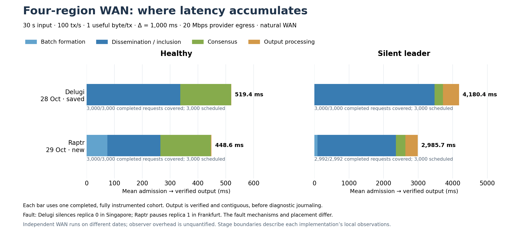

# Raptr WAN rerun and Delugi latency decomposition

On 29 October 2026, integrated Raptr ran exactly **two** four-region workloads:
healthy and silent first leader, each **30 seconds at 100 honest tx/s**. Both
execution, authentication and agreement checks passed. Delugi was not rerun;
its reference measurements are the saved 28 October runs.

Singapore, Frankfurt, London and Seoul each used one `ecs.g9i.xlarge` with four
CPUs, 16 GiB RAM and a 200 GiB disk. The preset retained one useful byte per
transaction, Δ=1,000 ms, 20 Mbps public egress, natural WAN over WireGuard,
no warmup and at most 15 seconds of drain. Native batching defaults and transport
settings match the prior run. Raptr tracing was enabled with a 250,000-event cap.
The [frozen parameters](parameters.json) and [record](record.json) bind the inputs,
Linux release `3b4a1d9`, binary, results and cleanup evidence.



## Common stage means

All values below are **milliseconds**, from successful origin-local admission to
verified contiguous application acceptance, before diagnostic journaling. Each
row uses one fully traced completed-request cohort; its stages sum to its total.
Proposal transit is included in dissemination/inclusion, before local proposal
acceptance. These consensus spans are not leader-broadcast-to-quorum durations.

| Case | Protocol | Batching | Dissemination / inclusion | Consensus | Output processing | Total | Covered / scheduled |
|---|---|---:|---:|---:|---:|---:|---:|
| Healthy | Delugi, saved | 0.63 | 336.21 | 182.44 | 0.12 | **519.40** | 3,000 / 3,000 |
| Healthy | Raptr, new | 74.67 | 190.54 | 180.87 | 2.50 | **448.58** | 3,000 / 3,000 |
| Silent leader | Delugi, saved | 0.66 | 3,472.68 | 242.20 | 464.91 | **4,180.45** | 3,000 / 3,000 |
| Silent leader | Raptr, new | 89.63 | 2,268.63 | 275.47 | 351.93 | **2,985.65** | 2,992 / 3,000 |

Healthy consensus time is almost equal. Raptr's lower total mainly reflects less
waiting for dissemination/proposal inclusion, offset by its longer batching.
With a silent leader, proposal waiting dominates both protocols. Raptr's smaller
mean accompanies lower in-window goodput in this pair of runs:

| Protocol / case | Admitted / completed / scheduled | Window goodput (tx/s) | Scheduled → output p50 / p95 (ms) |
|---|---:|---:|---:|
| Delugi healthy, saved | 3,000 / 3,000 / 3,000 | 98.23 | 518.83 / 668.17 |
| Raptr healthy, new | 3,000 / 3,000 / 3,000 | 98.50 | 445.80 / 595.43 |
| Delugi silent, saved | 3,000 / 3,000 / 3,000 | 93.03 | 4,250.20 / 7,248.25 |
| Raptr silent, new | 2,992 / 2,992 / 3,000 | 82.53 | 2,971.28 / 5,291.94 |

The eight missing Raptr requests were cancelled before admission at the finite
cutoff. They remain in the 3,000-request scheduled-cohort statistics, but have no
completed stage chain and therefore do not enter the stage means. Every admitted
request completed and every completed request has full stage coverage. All
seven collected honest-replica traces have zero dropped events. Goodput counts
only completions inside the 30-second input window; drain completions receive
no throughput credit. Means and quantiles describe different statistics.

## Raptr's newly visible stages

| Output substage, mean ms | Healthy | Silent leader |
|---|---:|---:|
| Payload retrieval / validation | 0.441 | 39.955 |
| Contiguous FIFO wait | 0.008 | 0.023 |
| Output consumer wait | 1.374 | 21.409 |
| Application acceptance | 0.677 | 290.539 |

The silent-case application span is substantial. Recovery emits large proof
sections with repeated transaction occurrences; `publish_observed` calls
`identify` before deduplication for each occurrence. That work includes request
and envelope checks, signature verification, BCS encoding and hashing. The
section's acceptance span is assigned to every newly credited local request;
290.539 ms is request-weighted section latency, not per-transaction verification
cost. The span also includes a blocking mutex acquisition and synchronous
admission-row reads, which these timestamps cannot isolate from CPU work.
There is no network operation, sleep or asynchronous wait inside it. Signed
counters show 51,634 workload signature verifications per silent replica,
consuming 2.14–2.32 thread-CPU seconds, versus 8,855 and 0.39–0.45 seconds healthy.
Large sections account for 99.63% of the request-weighted acceptance time.
This is output-adapter work, outside the consensus interval; the separate
consumer stage measures the preceding queue/scheduling wait. Diagnostic
construction follows the endpoint;
its request-weighted means are 0.181 ms healthy and 73.109 ms silent, and are not
added to the latency bars. It may still affect later work through contention.

Availability-quorum timing **overlaps** other stages. The stored-to-quorum mean
is 177.923 ms healthy and 261.505 ms silent. Quorum is observed after execution
proposal acceptance for 1,349 healthy and 214 silent completed requests. The
optional serial-quorum figure therefore covers only **1,651** and **2,778**
requests, with respective total means 500.789 and 3,141.961 ms. Those selected
cohorts must not replace the complete primary bars.

See the [seven-stage figure](raptr-detailed-stages.png),
[optional quorum figure](raptr-quorum-stages.png),
[common-stage CSV](common-stages.csv), [comparison JSON](comparison.json), and
the full [healthy](raptr-healthy-decomposition.json) and
[silent](raptr-silent-first-leader-decomposition.json) reductions.

## Interpretation and reproducibility

The endpoints align semantically, while native policies remain distinct. Raptr
uses a 4Δ leader timeout from round entry; Delugi uses its eligible 7Δ main timer
and independent 3Δ catch-up timers. Equal Δ does not mean equal recovery timeout.
Raptr retains 150 ms Quorum Store polling with an 80 ms minimum nonempty interval
and 300 ms maximum; Delugi retains a 10 ms maximum batch wait. Common batching
overrides were unset. Delugi releases ordered descriptors before materializing
payloads; Raptr validates payloads before FIFO release. Output is grouped to
compare the complete semantic boundary despite that ordering difference.

The fault also retains the original placements: Delugi silences replica 0 in
Singapore while transport ACKs remain active; Raptr pauses replica 1 in Frankfurt
from before arm until cleanup. The same faulty identity loses repeated leadership
slots; this does not test its reintegration. The runs occurred on different days.
Measured healthy ring RTTs are 156.834, 13.807, 239.723 and 64.427 ms; the first
path is about 5.66 ms faster than the saved Delugi probe, while the others are
similar. Ring probes do not characterize every committee edge. One run per case
and unqualified observer overhead limit this comparison to the observed runs.

The new release passed **28 Rust tests and five Linux supervisor tests** before
execution. All four instances and owned security groups were deleted after
collection; the remote build target was removed. The quote-based fleet estimate
is **CNY 14.07**, including build/setup time, pending final provider billing.
The CNY 100 reservation remains unsettled rather than being treated as refunded.
No additional local build was performed; the retained verifier target is 65 MiB.

The raw archive contains 212 files, with SHA-256
`e13c64398043ed90daacda0f121b7235743da49e8586364d44402c6b2f205f97`.
Its local path and all artifact bindings are in [record.json](record.json).
[Fabric summary JSON](summary.json) and [CSV](summary.csv) retain traffic counters
and their quality flags. Silent-run traffic samples are late at some boundaries,
so their byte total is not presented as an exact-window traffic comparison.

Recreate the figures from the downloaded evidence, without cloud access:

```sh
benchmarks/.cache/aliyun-python/bin/python \
  benchmarks/results/raptr-wan-stages-2026-10-29/plot_comparison.py \
  --run benchmark/.state/runs/raptr-wan-stages-20261029 \
  --output benchmarks/results/raptr-wan-stages-2026-10-29
```

The generator rechecks the saved Delugi hashes and re-reduces both protocols'
original traces. The figure is also available as [SVG](latency-decomposition-comparison.svg).
