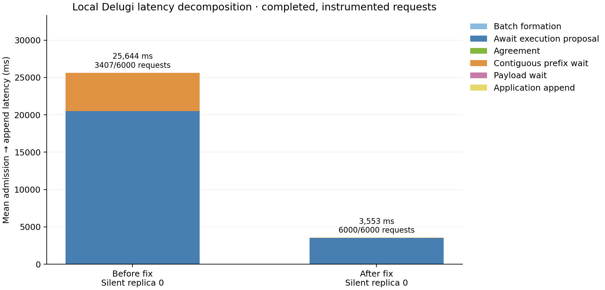
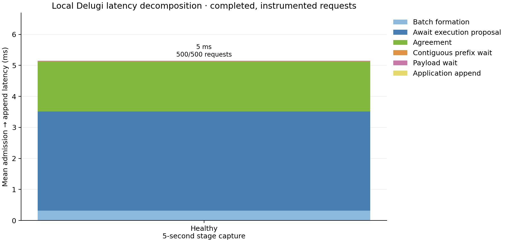

# Silent-leader correction: local evidence

Four independent Delugi processes; real authenticated loopback TCP; real crypto;
in-memory custody; 100 total honest tx/s; one useful byte; Δ = 1,000 ms;
60-second input window and at most 15 seconds of drain. No injected network delay
and no Aliyun activity. These runs diagnose behavior rather than predict WAN capacity.

| Run | Completed by collection | Window goodput | Admission → append median |
|---|---:|---:|---:|
| Silent replica, old REPORT trigger | 3,407 / 6,000 | 43.43 tx/s | ≥26,688 ms, censored |
| Silent replica, corrected trigger | 6,000 / 6,000 | 91.75 tx/s | 3,576 ms |
| Healthy, corrected trigger | 6,000 / 6,000 | 100.00 tx/s | 5.02 ms |

The old composition froze availability inputs at round admission. HISTORY3 then
held those inputs behind recurring silent leaders. Frozen input age reached
34.97 seconds. The corrected composition starts its one REPORT after admission
and exact history readiness; frozen input age remained below 0.9 ms.

The fault is permanent protocol silence at replica 0, so rounds 1, 5, 9, … have
silent leaders. The repeated 7Δ timeout cost remains. The new schedule is an
explicit revision of the pinned paper's entry-triggered REPORT; the old schedule
is retained as `admission`. Ordering guards, timers, immutable Q and scanner
semantics are unchanged.

The old bar covers only its 3,407 completed requests; unfinished requests are not
assigned an invented latency. Its completed-only mean is 25.64 s. The corrected
bar covers all 6,000 and averages 3.55 s. Stage means add over the same population
within each bar; no percentile sums or cross-replica clock subtraction are used.

The full-minute healthy trace exceeded its explicit event cap, and the reducer
rejected it. Its verified cohort still supplies the healthy row above. A separate
five-second stage capture covers all 500 requests with no drops; its mean is
5.15 ms. It is not a substitute one-minute run.

In the corrected silent run, HISTORY3 generation averaged 0.257 ms, encoded
messages averaged 2,401 bytes (maximum 2,532), and first-report-to-quorum collection
averaged 5.23 ms at leaders. The leader-local logical PROPOSE-to-direct-commit
span averaged 4.43 ms. The request-bar agreement boundary starts after local
full validation; proposal transit belongs to the preceding bar segment.

[Record and hashes](record.json), [leader preparation rows](leader-preparation.csv),
and [instrumentation contract](../../../docs/evaluation/latency-decomposition.md)
retain the endpoints, populations, trace limitations and source identities.
Validation: 268 Rust tests and 107 Python checks passed; 20 existing opt-in Rust
tests were skipped. The local process runs separately exercise the healthy and
persistent-silence paths. The fixed common Linux binary has not been deployed.
